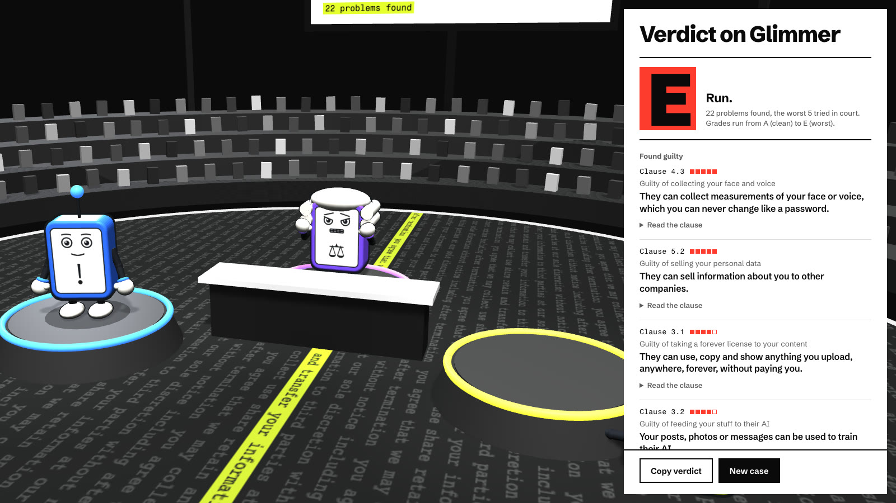

<div align="center">

# Fine Print Court

**Nobody reads the terms. So I put them on trial.**

### [▶ Try it here](https://fine-print-court.vercel.app)


</div>

Paste any app's Terms of Service. The worst clauses go on trial: the Prosecutor reads the charge, the clause makes a bad excuse, and the Judge tells you in plain English what you actually agreed to. You finish with a grade from **A** (clean) to **E** (run).

It catches things like selling your data, scanning your face, tracking your location and training AI on your photos. Everything runs in your browser, and nothing you paste is uploaded.

I was bored one weekend and vibe-coded it.



## Run it locally

```bash
npm install
npm run dev
```

## Good to know

- It finds bad clauses with simple rules, not AI, so it can miss unusual wording. Not legal advice.
- The voices come from [Kokoro](https://github.com/hexgrad/kokoro), which runs on your computer. The first visit downloads it (about 330 MB). Phones use the normal browser voice.
- Built on my other weekend project, [Font Debate](https://github.com/ShreyashAgare26/font-debate).

## License

[MIT](LICENSE). Third-party licenses are in [THIRD_PARTY_NOTICES.md](THIRD_PARTY_NOTICES.md).
