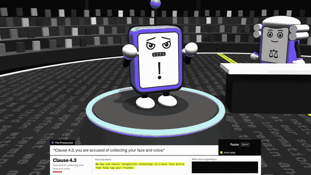
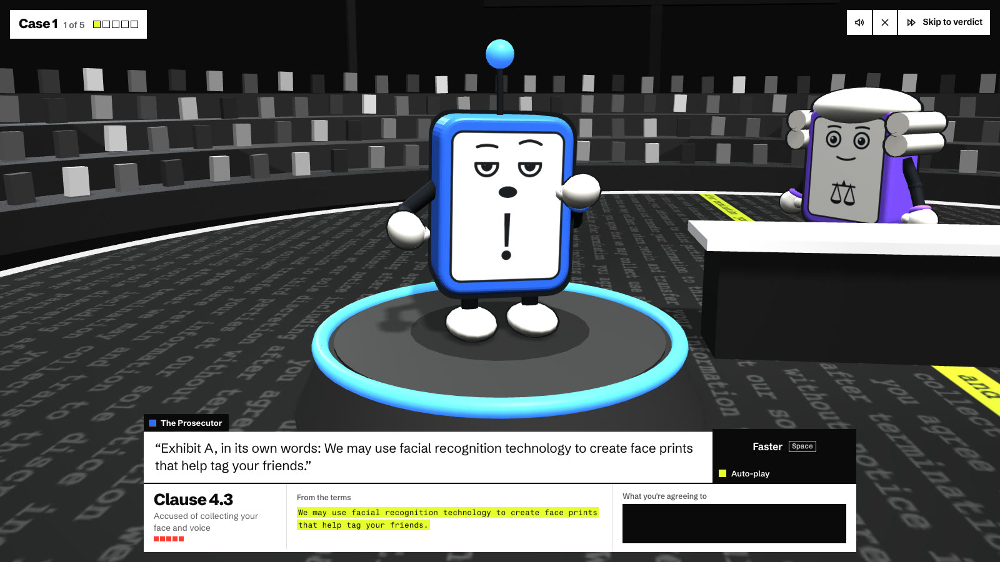
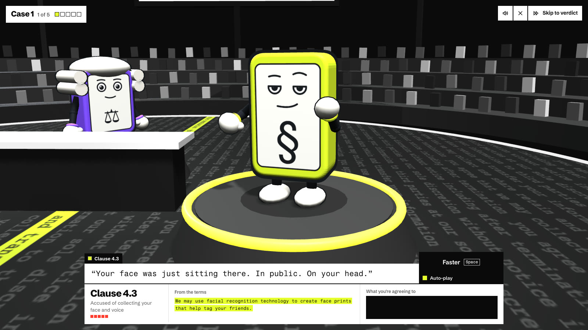
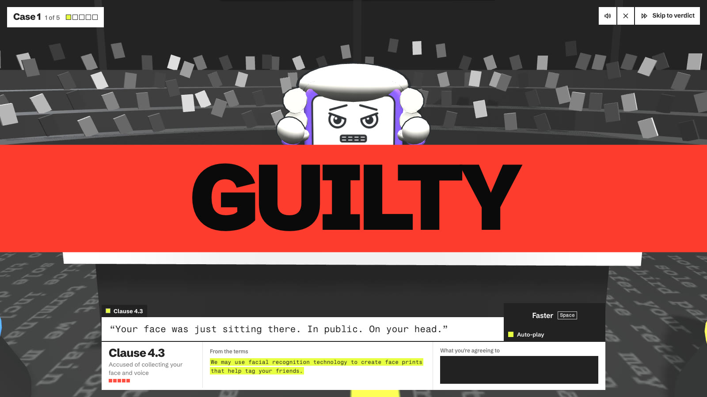

<div align="center">

# Fine Print Court

**Nobody reads the terms. So we put them on trial.**

Paste any app's Terms of Service or privacy policy. Its worst clauses get charged, argue back, and get a verdict that says what you're actually agreeing to.

### [▶ Try it: fine-print-court.vercel.app](https://fine-print-court.vercel.app)



</div>

## How a trial goes

1. **Paste the terms.** Or pick a sample. Everything runs in your browser; nothing is uploaded.
2. **The clerk files charges.** The worst clauses are pulled out, worst first, each named by its number in the document ("Clause 4.3").
3. **Court is in session.** For each case:
   - the **Prosecutor** reads the charge and the clause's own words
   - the **accused clause** defends itself (badly)
   - the **Judge** rules, and the plain-English verdict un-redacts on screen
   - the most serious offenders get thrown out of court
4. **The verdict.** A grade from A (clean) to E (run), with every problem found, including ones that didn't make the trial.

| The charge | The defence | The ruling |
| --- | --- | --- |
|  |  |  |


## What it catches

22 kinds of clause, each with a severity from 1 to 5, including:

- **Severe:** selling your data, collecting biometrics (face and voice), tracking your location, training AI on your content, a forever license to your posts, sharing with advertisers and data brokers, keeping data after you delete your account, forced arbitration, class-action bans
- **Watch out:** changing the terms whenever they like, suspending your account without reason, reading your messages, uploading your contacts, tracking you across other sites, auto-renewing subscriptions
- **Standard, but worth knowing:** limits on liability, making you pay their legal bills, no refunds, your data moving if the company is sold

A clause that *denies* doing something ("we never sell your data") is not charged.

## How it's built

- **Clause detection** (`src/charges.ts`): plain rules, not an AI model. The text is split into sentences, each tagged with its clause number, and matched against the 22 patterns. It's fast, free, private and testable. The tradeoff: unusual wording can slip through, and the report says so.
- **The courtroom**: [three.js](https://threejs.org) with hand-built vinyl-toy characters, canvas-drawn faces and scripted camera shots.
- **The voices**: [Kokoro](https://github.com/hexgrad/kokoro), an 82M-parameter text-to-speech model, running *in your browser* on WebGPU via [kokoro-js](https://www.npmjs.com/package/kokoro-js). It runs in a worker so the scene never stutters. The first visit downloads the model (about 330 MB, then cached). Phones and browsers without WebGPU use the browser's built-in voice instead.
- **Design**: a redaction look. White paper, black bars, and one highlighter colour, used only on the words that matter.
- Vite and TypeScript, no framework, no backend.

## Run it yourself

You need [Node.js](https://nodejs.org).

```bash
npm install
npm run dev     # open the link it prints
npm test        # checks the clause rules
npm run build   # production build in dist/
```

## Credits

- The 3D engine, characters and voices started life in [Font Debate](https://github.com/ShreyashAgare26/font-debate), where three fonts fight for your brand.
- "Glimmer" and "Tidy Notes" in the samples are made-up companies.

**Not legal advice.** It's a fun way to find the parts worth reading. For anything that matters, read the actual terms.
